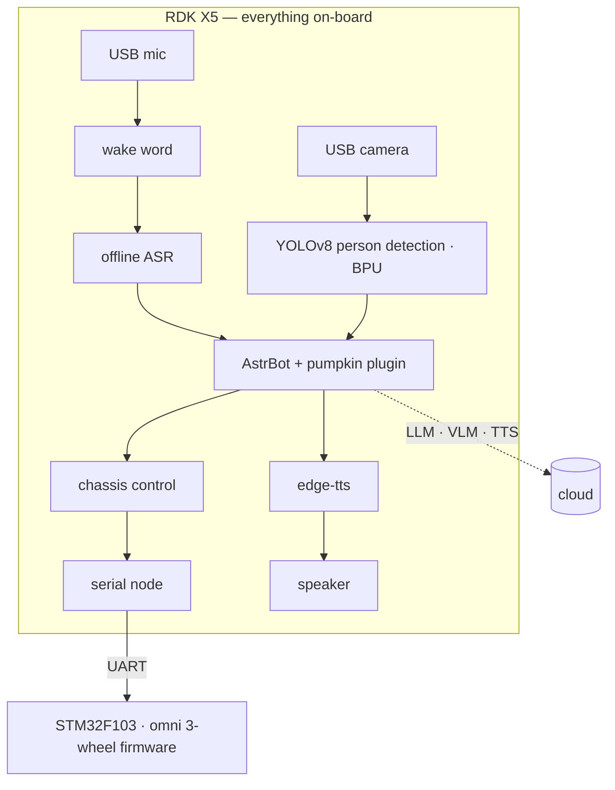

# Pumpkin 🎃

**Demo video:** <!-- TODO: 填链接 -->

We brought her to life by running [AstrBot](https://github.com/AstrBotDevs/AstrBot) on an RDK X5 and connecting it to her mobile base, microphone, camera, and speaker: now she can **see, hear, move, and speak — and has her own personality, powered by an LLM**.

There's no remote control and no fixed list of commands — she decides for herself when to move or look around. Ask her to dance, and she'll spin and dance her way back to where she started; ask her what she sees, and she'll take a look with her own camera and tell you. She's more than a robot that follows commands — she's a little companion you can talk to, in Chinese and English.

## She can

- **Talk** — say "南瓜" and she wakes up. She hears you with fully offline ASR on the X5, thinks with an LLM persona, and answers in her own neural voice.
- **Move** — her chat brain drives an omnidirectional 3-wheel base straight from conversation: closed-loop moves, returns home after a dance, hard e-stop for safety.
- **See** — a fine-tuned YOLOv8 person detector runs on the BPU, and she narrates what her own camera sees through a VLM.
- **A single RDK X5 carries the whole robot** — hearing, vision, and motion all run on-device; the cloud is only used for the LLM, VLM, and TTS. No laptop riding along.

## How it works

## Inside the repo

| Path | What it is |
|---|---|
| `robot-x5/` | Everything that runs on the X5: voice front end, chassis control, serial node, BPU vision service, and the AstrBot plugin |
| `firmware/` | STM32 firmware (C, CMake): omni kinematics, motor control, IMU, UART protocol |
| `training/` | The ML pipeline that produced the detector: auto-labeling → label audit → dataset assembly → ONNX export → uint8 PTQ → BPU conversion |
| `bench/` | Latency benchmarks for the whole voice loop |
| `docs/` | UART protocol spec |

## Getting started

1. **Firmware**: build `firmware/` as a CMake project and flash it. Protocol: `docs/PROTOCOL_UART.md`.
2. **Robot side**: on the X5, install `sherpa-onnx` / `ffmpeg` / `edge-tts`, drop the ASR & KWS models into `~/magicbox/`, run AstrBot (docker) with `robot-x5/astrbot_plugin_pumpkin/` installed, then start `pumpkin_serial_node.py` and `pumpkin_voice.py`. Say "南瓜".
3. **Vision**: the quantized BPU model is included at `robot-x5/vision/pumpkin_v2.bin`.
4. **Your own detector**: follow the scripts in `training/` in order.

## Acknowledgments

Built on great open projects: [AstrBot](https://github.com/AstrBotDevs/AstrBot), [sherpa-onnx](https://github.com/k2-fsa/sherpa-onnx), [edge-tts](https://github.com/rany2/edge-tts), [Ultralytics YOLOv8](https://github.com/ultralytics/ultralytics), and the RDK X5 / TROS toolchain. MIT licensed.
