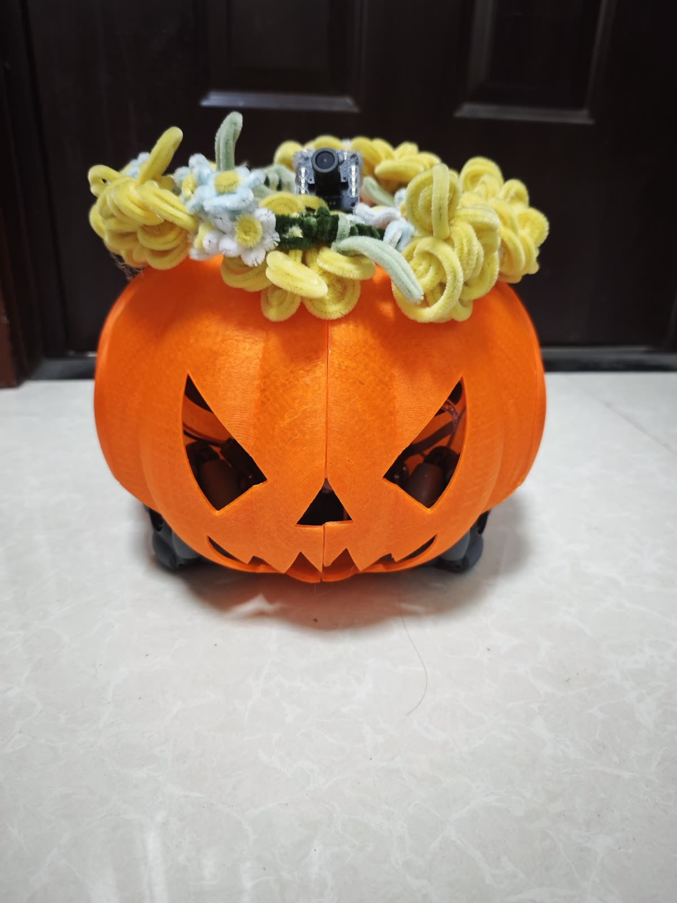

# Pumpkin 🎃 — a conversational robot with a body and eyes

<!-- TODO: 换成一张她的照片 or GIF -->
<!--  -->

**Demo video:** <!-- TODO: 填 B站/YouTube 链接 -->

Pumpkin is an omnidirectional 3-wheeled robot powered by a single RDK X5 board. We brought her to life by running [AstrBot](https://github.com/AstrBotDevs/AstrBot) on the X5 and connecting it to her mobile base, microphone, camera, and speaker — so she can **see, hear, move, and speak, with a personality of her own**.

There's no remote control and no fixed command list. She decides for herself when to move or look around: ask her to dance, and she'll spin and dance her way back to where she started; ask her what she sees, and she'll take a look with her own camera and tell you. She's more than a robot that follows commands — she's a little companion you can talk to (Chinese and English).

## Highlights

- **Fully voice-native interaction** — wake word ("南瓜 / Pumpkin") → on-device offline ASR → LLM with a custom persona → neural TTS voice. No cloud for hearing, no button to press.
- **The LLM drives the body** — the chat model emits a structured action protocol (turn / move / strafe / return-home) that is executed closed-loop on a custom omnidirectional chassis with odometry feedback, heartbeat watchdog, and a hard e-stop.
- **The LLM drives the eyes** — on request she captures a frame from her own camera and describes it through a VLM, while a fine-tuned YOLOv8 person detector runs continuously on the BPU.
- **Everything on one RDK X5** (8×A55 + 10 TOPS BPU) — no laptop riding on the robot.
- **Full-stack, self-built**: MCU firmware (C) → robot side (Python/ROS2) → data pipeline → model fine-tuning → quantization → BPU deployment.

## Architecture

```
                 ┌──────────────────────── RDK X5 (all on-board) ───────────────────────┐
                 │                                                                      │
 "南瓜!" ──► KWS (sherpa-onnx zipformer) ──► ASR (sherpa-onnx Paraformer int8, CPU)      │
                 │        (48kHz native USB mic ─► resample 16k ─► 1s-silence VAD)       │
                 │                    text ▼                                            │
                 │            AstrBot (docker) + pumpkin plugin ◄── LLM (cloud API)     │
                 │              │            │                                          │
                 │   motion JSON│            │camera frame ─► VLM (cloud)               │
                 │              ▼            │                                          │
                 │      pumpkin_chassis      │   pumpkin_vision: YOLOv8 person          │
                 │   (P-control + decel      │   (uint8 PTQ, BPU 10TOPS)                │
                 │    curve, closed-loop)    │                                          │
                 │              │ /cmd_vel   │                                          │
                 │              ▼            │                                          │
                 │     pumpkin_serial_node ──┘                                          │
                 │     (custom UART: handshake, 20Hz CMD_VEL, watchdog)                 │
                 └──────────────────────────────┬───────────────────────────────────────┘
                                                │ UART
                                 ┌──────────────▼──────────────┐
                                 │   MCU firmware (this repo)  │
                                 │ omni 3-wheel kinematics ·   │
                                 │ motor PID · ICM20948 IMU ·  │
                                 │ heartbeat watchdog · OLED   │
                                 └─────────────────────────────┘
        Voice out: edge-tts ─► speaker      Vision out: camera ─► VLM snapshots
```

## Repository layout

| Path | What it is |
|---|---|
| `robot-x5/` | Everything that runs on the X5: voice front end (`pumpkin_voice.py`), chassis interface with closed-loop control (`pumpkin_chassis.py`), serial node (`pumpkin_serial_node.py`), BPU vision service (`vision/`), and the AstrBot plugin (`astrbot_plugin_pumpkin/`) |
| `firmware/` | MCU firmware (C, CMake): omnidirectional kinematics, motor control, IMU, UART protocol |
| `training/` | PC-side ML pipeline: auto pre-labeling → COCO-assisted label audit → dataset assembly → 6-output ONNX export → uint8 PTQ calibration → BPU conversion config |
| `bench/` | Latency benchmark scripts that decompose the whole voice loop |
| `docs/` | UART protocol spec |
| `media/` | Photos |

## What runs where

- **RDK X5**: wake word + ASR (sherpa-onnx, offline, int8), AstrBot docker (LLM agent + persona + plugin), ROS2 serial bridge, BPU person detection, TTS playback
- **MCU**: 3-wheel omnidirectional kinematics, per-wheel motor PID, IMU fusion, safety watchdog (heartbeat loss ⇒ stop)
- **Cloud**: LLM, VLM and TTS only. Hearing, vision and motion are 100% on-device.

## Quick start

1. **Firmware**: open `firmware/` as a CMake project, build for your MCU, flash. Serial baud and protocol: see `docs/PROTOCOL_UART.md`.
2. **X5 robot side**:
   - Python deps: `sherpa-onnx`, `numpy`, `alsaaudio` (or your ALSA capture), `edge-tts`, `requests`; ROS2 Humble from TROS.
   - Download ASR/KWS models (k2-fsa sherpa-onnx releases: `sherpa-onnx-paraformer-zh-2023-09-14`, `sherpa-onnx-kws-zipformer-wenetspeech-3.3M-2024-01-01`) into `~/magicbox/`.
   - Run AstrBot (docker) and drop `robot-x5/astrbot_plugin_pumpkin/` into its plugin dir; configure your LLM API key inside AstrBot.
   - `ros2 run` style: start `pumpkin_serial_node.py`, then `pumpkin_voice.py`. Say "南瓜".
3. **Vision**: `robot-x5/vision/pumpkin_v2.bin` is the quantized BPU model (included); run `cam_infer.py` with the RDK d-node runtime.
4. **Training your own detector**: see `training/` scripts in order: `prelabel.py` → `audit_labels.py` → `assemble_ft.py` → fine-tune → `export_6out.py` → `make_calib_new.py` → convert with hb_mapper using `convert_6out.yaml`.

## Latency

`bench/` decomposes the whole voice loop — ~6.5s round trip today:

| Stage | Typical | Note |
|---|---|---|
| End-of-speech detection | 1.0s | silence window |
| ASR (Paraformer int8, 2 threads) | ~0.8s | fully offline |
| LLM (AstrBot → cloud API) | ~1.4s | first token + short reply |
| TTS (edge-tts, full sentence) | ~3.3s | current bottleneck; streaming is the next step |

## Engineering notes

- **48kHz or nothing**: letting ALSA resample our USB mic to 16k in hardware destroyed the audio; capturing 48kHz natively and resampling in software fixed recognition completely.
- **Sigmoid stays out of the BPU**: exporting YOLOv8 as 6 raw outputs (reg + cls logits, per stride) and doing decode/Sigmoid in postprocess made uint8 PTQ accuracy usable; the stock export path didn't.
- **Speed killed the dance**: raising the turn rate to the protocol max caused ±100° overshoot oscillation. The fix is boring and effective: cap the angular velocity and follow a deceleration curve `v ≤ √(2·a·err)` so she always brakes in time.
- **Local neural TTS on A55 cores doesn't fly**: measured RTF 2.9 (melo) and 6.5 (kokoro-int8) — a 4-second reply took 20–55s to synthesize. Cloud TTS stays; streaming sentence-by-sentence is the plan.
- **Oversampling beats retraining**: fine-tuning on just 105 new frames would both overfit and forget; oversampling them ×20 inside the 66k-image base set gave +31pt person precision on new scenes with −0.3pt on the original val.

## Bill of materials

<!-- TODO: 补型号 -->

| Part | Model | Qty | Note |
|---|---|---|---|
| Brain | RDK X5 (8×A55, 10 TOPS BPU) | 1 | runs everything on-robot |
| MCU | STM32F103xE (Cortex-M3) | 1 | firmware in `firmware/` |
| Chassis | custom 3-wheel omnidirectional | 1 | TODO material/size |
| Motors | TODO (with encoder) | 3 | |
| Camera | TODO USB camera (MJPG) | 1 | |
| Microphone | TODO USB mic (must do 48kHz native) | 1 | |
| Speaker | TODO | 1 | |
| Power | TODO | | |

## Next steps

- Stream TTS sentence-by-sentence — the biggest remaining latency cut (first sound ~3.3s → under 1s).
- Follow-me behavior using the on-board person detector.
- One more round of training data (night scenes, side angles) for the detector.
- An English-capable ASR model for long English sentences.

## License

MIT — see `LICENSE`. The vision model is fine-tuned from Ultralytics YOLOv8 (AGPL-3.0).

## Acknowledgments

Built on great open projects: [AstrBot](https://github.com/AstrBotDevs/AstrBot), [sherpa-onnx](https://github.com/k2-fsa/sherpa-onnx), [edge-tts](https://github.com/rany2/edge-tts), [Ultralytics YOLOv8](https://github.com/ultralytics/ultralytics), RDK X5 / TROS toolchain.
